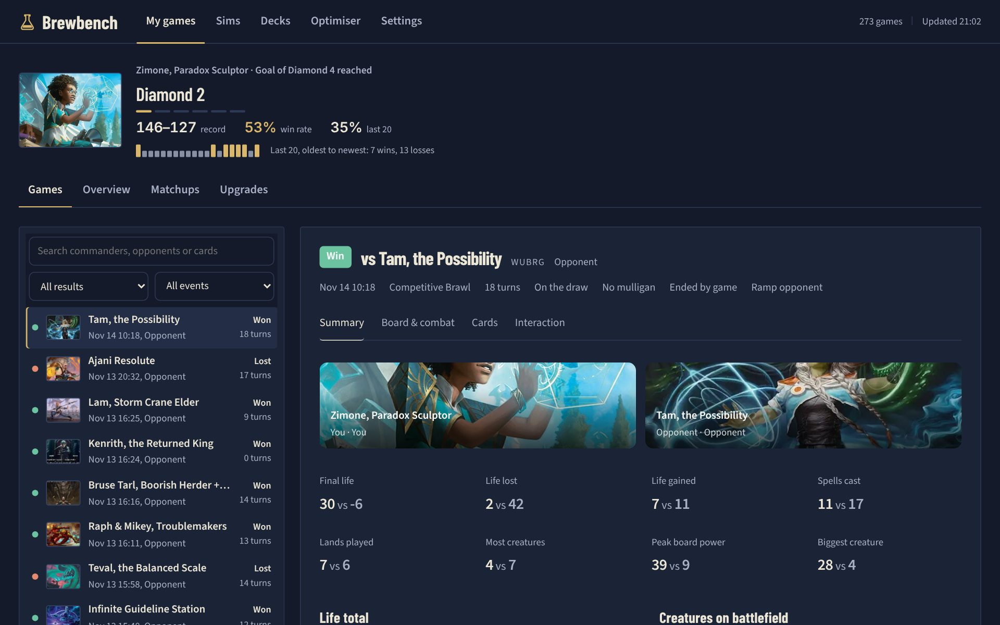
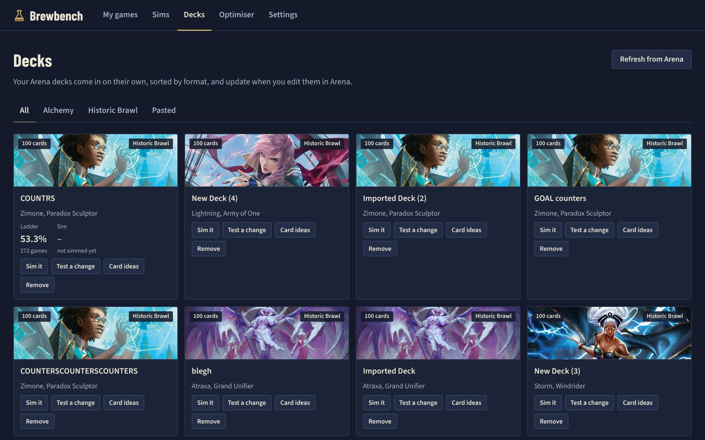
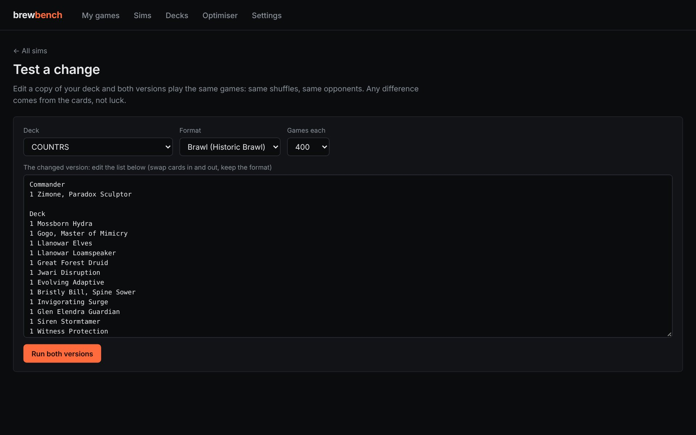
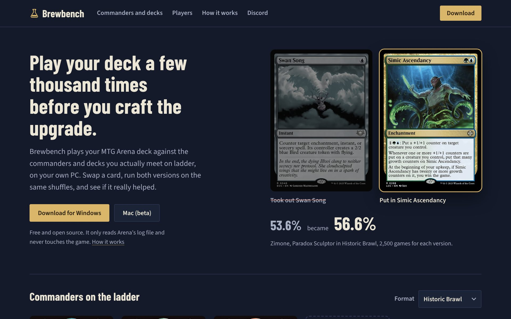

# Brewbench

Simulate your MTG Arena decks before you spend wildcards on them.

Brewbench takes a decklist (pasted from Arena's Export button, or read straight from your Arena log) and plays
hundreds of games against a gauntlet of opponent decks, using the AI from [Forge](https://github.com/Card-Forge/forge),
the open-source Magic rules engine. You get a win rate with an honest error bar, how you do on the play and on
the draw, and which matchups are your worst. You can also A/B test two versions of a deck on the same gauntlet
to see whether a change actually helped.

**Formats:** Brawl (Historic Brawl), Standard Brawl, Standard, Historic, Timeless, Alchemy. Alchemy's rebalanced
digital cards mostly aren't in Forge; `deck check` tells you which cards would be left out.

Brewbench only reads Arena's log file. It never touches the game client, its memory, or its network traffic,
and it gives no advice during games.

## What it is and isn't

Forge's AI is a competent but imperfect player. It misplays some cards (Forge marks many of them itself, and
`deck check` lists any in your deck), so treat results as *relative* evidence: "version B beats version A on
this gauntlet by 4 points" is far more trustworthy than "this deck is a 57% deck on ladder".

Win rates need many games. Telling a 3-point difference apart takes about 2,000 games per deck; `compare`
tells you when a result is still too close to call.

## Install

**Windows:** download [brewbench-setup.exe](https://mtgasim.roododger.workers.dev/download/windows)
and run it. Brewbench opens as a normal app with a tray icon, fetches Java and Forge for you on first run, reads
your Arena decks and the opponents you've faced, and tells you when an update is out.

**Mac (beta):** [brewbench-mac.zip](https://mtgasim.roododger.workers.dev/download/mac).
It isn't signed yet, so right-click the app and choose Open the first time.

Questions, bugs or results to share: join the [Brewbench Discord](https://discord.gg/kTnCXydsgC).

In Arena, turn on *Options > Account > Detailed Logs (Plugin Support)* so Brewbench can read your decks.



| Your decks, ladder vs sim | Test a change |
|---|---|
|  |  |

The public site, [mtgasim.roododger.workers.dev](https://mtgasim.roododger.workers.dev), shows what's winning
across everyone who chooses to share:



## Command line

Everything the app does is also available from the command line (Python 3.9+, Java 17+,
[Forge](https://github.com/Card-Forge/forge/releases) 2.0.16):

```
pip install git+https://github.com/roodolpha/MTGASIM.git
brewbench setup --forge-dir "C:\Games\Forge"
brewbench doctor
```

### Commands

```
# your deck
brewbench deck import my_deck.txt --name "Izzet Prowess" --format standard
brewbench deck from-log                 # list decks from your Arena log
brewbench deck from-log --pick 1

# opponents
brewbench gauntlet add standard mono_red.txt dimir_midrange.txt domain.txt
brewbench gauntlet from-log             # Brawl: one deck per commander you've faced

# simulate
brewbench run "Izzet Prowess" -f standard -n 500
brewbench compare "Izzet Prowess" "Izzet Prowess v2" -f standard -n 2000
brewbench report

# test card swaps automatically and keep the ones that really help
brewbench optimise "Izzet Prowess" -f standard --pool candidates.txt --hours 8

# local dashboard in your browser (runs, matchups, decks, optimiser)
brewbench serve

# opt in: share your results with the public site (see "Sharing" below)
brewbench share --preview
brewbench share --name "YourName" --public
```

Useful options: `-j 6` games at once (default: half your CPU threads), `--vs` to pick opponent decks or folders,
`--seed` to make a run repeatable, `brewbench setup --ai Hardest` for Forge's strongest (and slowest) AI.

Everything lives in `~/.brewbench` (decks, gauntlets, results as JSON lines, caches). Set `BREWBENCH_HOME` to move it.

## The optimiser

`optimise` tries one-card swaps (cut one card, add one from your pool) and keeps a swap only if it survives
three checks: a short screening run, a longer run that has to clear about 95% confidence, and a run against
opponent decks it was never tuned on. Both versions play the same seeded games, so the comparison only has to
beat the noise from games where the swapped card actually mattered. Accepted swaps become the new list and the
search carries on; stop it whenever and run it again to resume. The current best list is saved in Arena import
format under `~/.brewbench/optimiser/<deck>/optimised.txt`.

## Sharing (opt in)

Nothing leaves your PC unless you turn sharing on (Settings in the app, or `brewbench share`). It sends your real Arena games (day, format, result,
your deck's colours or commander, the opponent's colours or commander), your simulator summaries, and, only
with `--lists`, your decklists. Arena match ids are hashed, times are cut to the day, opponents are never named,
and your Arena name is never read. You're anonymous unless you pick `--name` and `--public`.
`brewbench share --forget` deletes everything you've sent. The public API is described in `docs/API.md`.

## Data sources

* Card names: Arena's own card database on your PC when present, otherwise [Scryfall](https://scryfall.com/docs/api).
* Legality and colour identity: Scryfall.
* Brawl opponent lists: the cards you saw each opponent play, optionally topped up with [EDHREC](https://edhrec.com)'s
  average deck for that commander (off by default: turn it on in Settings or with `--edhrec`).

## Licence

Brewbench is free software under the GNU GPL v3 (see `LICENSE`), because its Java harness links against Forge,
which is GPL v3. The harness source is in `harness/src`.

Brewbench is unofficial Fan Content permitted under the Fan Content Policy. Not approved/endorsed by Wizards.
Portions of the materials used are property of Wizards of the Coast. ©Wizards of the Coast LLC.
